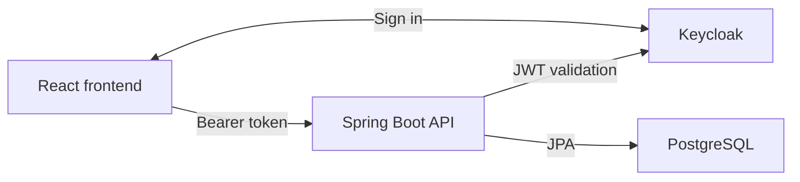

# Airport Badges — Spring Boot API


Backend for the airport badge and access application I built during my 2025 internship at Royal Air Maroc.

[React frontend](https://github.com/hamza-lzr/badges-app-frontend) · [My portfolio](https://lazaar.netlify.app/)

## Start with the code

- [Badge handling](src/main/java/com/ram/badgesapp/services/BadgeService.java) and [airport access](src/main/java/com/ram/badgesapp/services/AccessService.java)
- [JWT validation, realm roles and CORS](src/main/java/com/ram/badgesapp/config/SecurityConfig.java)
- [DTO mapping](src/main/java/com/ram/badgesapp/mapper/BadgeMapper.java)
- [Controller, service and mapper tests](src/test/java/com/ram/badgesapp)

## What it does

- Manages users, companies, countries, cities, and airports
- Issues badges and assigns time-bounded airport access
- Tracks leave requests, notifications, and badge status
- Synchronizes Keycloak users with the application database
- Secures API endpoints with JWT authentication and role-based authorization

## Tech stack

- Java 17 and Spring Boot 3
- Spring Web, Spring Data JPA, and Spring Security
- PostgreSQL
- Keycloak OAuth 2.0 / OpenID Connect
- MapStruct and Lombok
- JUnit 5, Mockito, MockMvc, JaCoCo, and SonarQube
- Docker and Maven Wrapper

## Architecture



Inside the API: controllers handle requests, services apply the rules, repositories access the database, and MapStruct maps entities to DTOs.

Application code lives under `src/main/java/com/ram/badgesapp`, grouped by controller, service, repository, entity, DTO, mapper, and configuration concerns.

## Prerequisites

- JDK 17 or newer
- PostgreSQL
- Keycloak with a realm, roles, and an admin service client configured

## Configuration

Clone the backend first:

```bash
git clone https://github.com/hamza-lzr/badgesApp.git
cd badgesApp
```

Copy `.env.example` and provide values through your IDE, shell, container runtime, or deployment platform. The application intentionally does not load `.env` files by itself.

The most important variables are:

| Variable | Purpose |
| --- | --- |
| `DB_URL`, `DB_USERNAME`, `DB_PASSWORD` | PostgreSQL connection |
| `KEYCLOAK_ISSUER_URI` | JWT issuer used by the resource server; must match the frontend realm |
| `KEYCLOAK_SERVER_URL` | Keycloak base URL |
| `KEYCLOAK_ADMIN_REALM`, `KEYCLOAK_TARGET_REALM` | Realm used for the admin client and realm containing application users |
| `KEYCLOAK_ADMIN_CLIENT_ID`, `KEYCLOAK_ADMIN_CLIENT_SECRET` | Keycloak admin service client |
| `KEYCLOAK_SYNC_ON_STARTUP` | Enables the optional admin-user sync at startup |
| `CORS_ALLOWED_ORIGINS` | Comma-separated trusted frontend origins |

Defaults for local service URLs are defined in [`application.properties`](src/main/resources/application.properties); secrets have no committed default.

The frontend uses `http://localhost:5173` and the `ram` realm by default. Keep `CORS_ALLOWED_ORIGINS` and `KEYCLOAK_ISSUER_URI` aligned with its configuration. Startup synchronization imports `ADMIN` users from Keycloak; it uses the backend admin client, separate from the public frontend client.

## Run locally

On Windows:

```powershell
.\mvnw.cmd spring-boot:run
```

On macOS or Linux:

```bash
./mvnw spring-boot:run
```

The API starts on `http://localhost:8080` by default. Protected endpoints require a bearer token issued by the configured Keycloak realm.

## Tests

The test suite uses an in-memory H2 database in PostgreSQL compatibility mode, so PostgreSQL and Keycloak do not need to be running:

```powershell
.\mvnw.cmd test
```

On macOS or Linux:

```bash
./mvnw test
```

JaCoCo writes the coverage report to `target/site/jacoco/index.html`.

## Docker

Build the application image from the repository root:

```bash
docker build -t badges-app .
```

Pass the configuration variables at runtime and ensure the container can reach PostgreSQL and Keycloak.

## Project history

See [CHANGES.md](CHANGES.md) for the Keycloak synchronization feature notes.

## Security note

Never commit real database passwords, client secrets, tokens, or private environment files. If a secret has ever been committed, rotate it at the provider; removing it from the latest revision does not remove it from Git history.
